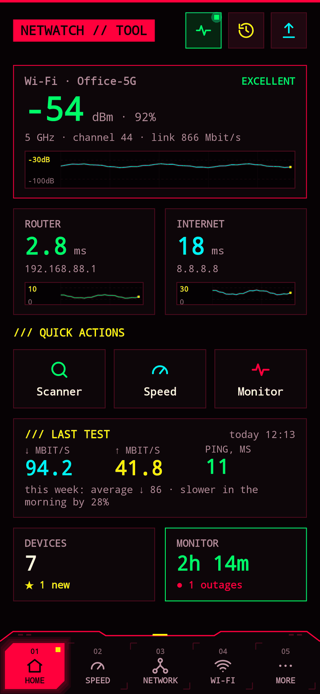
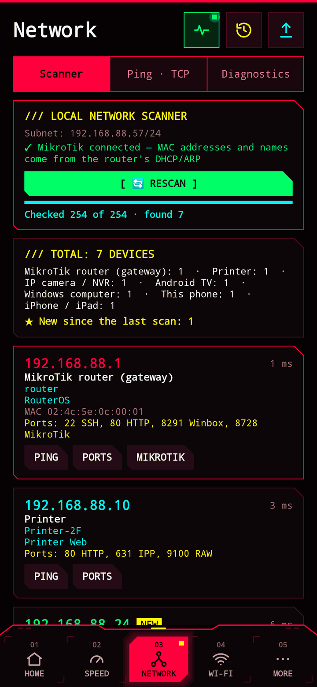
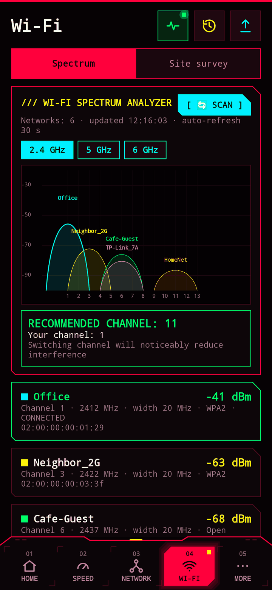
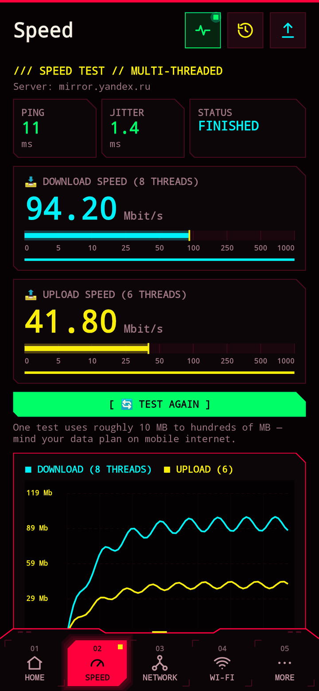
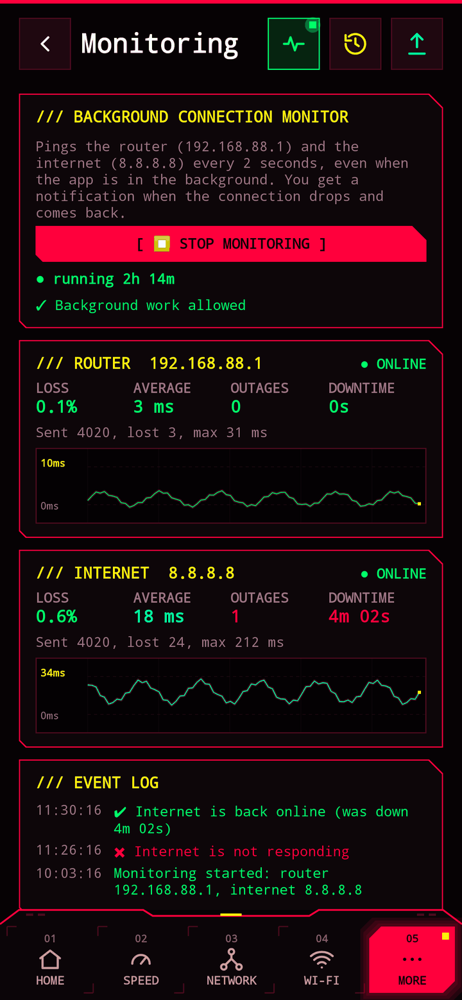
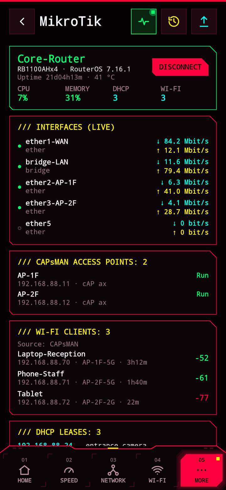
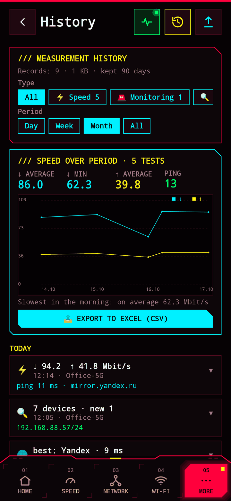
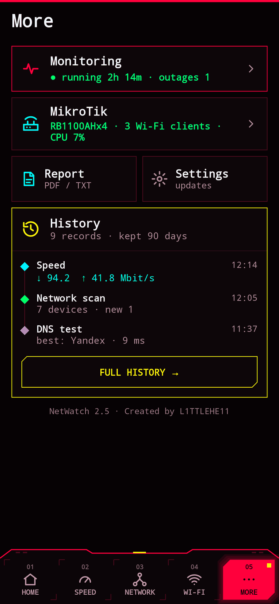

<div align="center">

**English** | [Русский](README.ru.md)


# NetWatch: Network Scanner

**Free network scanner and Wi-Fi analyzer for Android**<br>
LAN scanner · Wi-Fi channels · ping · speed test · outage monitor · traceroute · ports · MikroTik

[](https://github.com/L1TTLEHE11/NetWatch/raw/main/apk/NetWatch-2.5-universal.apk)
[](#install)
[](LICENSE)
[](#privacy)

### [📥 Download APK](https://github.com/L1TTLEHE11/NetWatch/raw/main/apk/NetWatch-2.5-universal.apk) · [Website](https://l1ttlehe11.github.io/NetWatch/)

</div>

<table>
<tr>
<td></td>
<td></td>
<td></td>
<td></td>
</tr>
<tr>
<td></td>
<td></td>
<td></td>
<td></td>
</tr>
</table>

NetWatch is a toolkit for people who set up and fix networks — from a home router to a hotel with a dozen access points. Everything in one app, free, with no ads and no data collection. It started as the Android port of the NetWatch desktop utility (Python / Tkinter).

## Features

| Section | What it does |
|---|---|
| **01 Home** | Wi-Fi signal in dBm with a graph, ping to the router and the internet, quick actions, last speed test and weekly summary, devices on the network, monitor status |
| **02 Speed** | Multi-threaded test (8 streams ↓, 6 ↑), numbers and bars update 10 times per second, ping and jitter, graph and history |
| **03 Network → Scanner** | All subnet devices in 10–30 s, device type (router, MikroTik, camera, printer, Android TV, Smart TV, PC, iPhone, NAS), open ports, names via NetBIOS, mDNS and UPnP, a “NEW” tag for new devices |
| **03 Network → Ping · TCP** | Live ping of any host with loss statistics, TCP throughput test to a LAN device, Wake-on-LAN |
| **03 Network → Diagnostics** | Traceroute, DNS benchmark (ISP, Google, Cloudflare, Yandex, Quad9, AdGuard), port scanner with service names, interfaces and routes |
| **04 Wi-Fi → Air** | All nearby networks, 2.4 / 5 / 6 GHz channel load graph, best channel recommendation |
| **04 Wi-Fi → Survey** | Measurements per location (“room 204”, “reception”): signal, access point, ping, loss, speed; weak spots are highlighted; export to Excel and PDF |
| **05 More → Monitor** | Background router and internet checks every 2 s, outage notifications, loss, downtime, event log |
| **05 More → MikroTik** | RouterOS API (v6 and v7): CPU, memory, temperature, interface traffic, CAPsMAN access points, Wi-Fi clients with signal, DHCP leases |
| **05 More → History** | Every test, scan and session is saved automatically; filters by type, network and period; speed summary with Excel export |

Also: one-tap PDF report, home-screen widget, large font, in-app updates with SHA-256 verification.

**Languages:** English and Russian — follows the system language, switchable in “More → Settings → Language”.

## Install

1. Download [**NetWatch-2.5-universal.apk**](https://github.com/L1TTLEHE11/NetWatch/raw/main/apk/NetWatch-2.5-universal.apk). One file for every device on Android 8.0+ (arm64-v8a, armeabi-v7a, x86, x86_64).
2. Open it on the phone and allow installs from this source.
3. Allow location access when asked: without it Android hides the Wi-Fi network name.

After that the app updates itself: “More → Settings → Updates”.

SHA-256: `134a3c75f8ba4f9bd2405fd41f231d6ae312f0a10106d34b9df1202685e72b89`

## Privacy

NetWatch **collects nothing and sends nothing anywhere**: no analytics, no ads, no accounts, no servers. History stays on the phone. Details: [privacy policy](https://l1ttlehe11.github.io/NetWatch/privacy.html).

| Permission | Why |
|---|---|
| `INTERNET`, `ACCESS_NETWORK_STATE`, `ACCESS_WIFI_STATE` | pings, tests, network parameters |
| `ACCESS_FINE/COARSE_LOCATION` | without it Android hides the SSID and Wi-Fi scan results; coordinates are never used |
| `CHANGE_WIFI_STATE` | starting a Wi-Fi scan |
| `FOREGROUND_SERVICE`, `WAKE_LOCK`, `POST_NOTIFICATIONS` | background monitor and outage notifications |
| `REQUEST_INSTALL_PACKAGES` | installing updates downloaded by the app |

## Translations

Want NetWatch in your language? Translate `app/src/main/res/values/strings.xml` (the English source) and send it as `values-<language code>/strings.xml` in a pull request or an issue. See [CONTRIBUTING.md](CONTRIBUTING.md).

## Bugs and ideas

Found a bug or have an idea? [Open an issue](https://github.com/L1TTLEHE11/NetWatch/issues/new/choose). Pull requests are welcome.

## For developers

**Kotlin + Jetpack Compose**, minSdk 26, targetSdk 35. No third-party networking libraries: RouterOS API, mDNS, SSDP, NetBIOS, DNS and Wake-on-LAN are implemented in the project.

```bash
# needs JDK 17+ and Android SDK (platform 35, build-tools 35)
echo "sdk.dir=/path/to/Android/Sdk" > local.properties
./gradlew assembleRelease          # APK: app/build/outputs/apk/release/
./gradlew testDebugUnitTest        # protocol tests + screen screenshots (Robolectric + Roborazzi)
```

<details>
<summary>Signing, releases, project layout</summary>

**Signing.** Release builds are signed with the key from `keystore.properties` → `keys/netwatch-release.jks` (both in `.gitignore`). An update installs over the old version only when signed with the same key. Without `keystore.properties` the build is signed with the debug key.

**Releasing a version.**
1. Bump `versionCode` and `versionName` in `app/build.gradle.kts`.
2. `./gradlew assembleRelease`
3. `python3 tools/release.py --en "What's new" … --ru "Что нового" …` — APK into `apk/` (the 3 latest are kept), `update.json`, links in the READMEs and on the site, changelogs for app catalogs.
4. `git push`, then `curl -s https://purge.jsdelivr.net/gh/L1TTLEHE11/NetWatch@main/update.json`.

**Screenshots for README and site:** `./gradlew testDebugUnitTest --tests '*DemoShots*'` (screens with sample data → `docs/screenshots/en/` and `docs/screenshots/ru/`), then `python3 tools/store_art.py .`

```
update.json                — current version for in-app updates
tools/release.py           — publishing a new version
docs/                      — website (GitHub Pages): English at the root, Russian in docs/ru/
fastlane/metadata/android/ — descriptions and images for app catalogs
app/src/main/res/values*/strings.xml — UI texts (values — English, values-ru — Russian)
app/src/main/java/com/pshenov/netwatch/
├── NetVm.kt, Features.kt  — screen state and logic
├── Net.kt                 — ping, Wi-Fi / cellular, gateway, speed tests
├── Tools.kt               — LAN and port scanner, traceroute, DNS, NetBIOS, Wake-on-LAN
├── Discovery.kt           — device discovery via mDNS and SSDP/UPnP
├── WifiScan.kt            — Wi-Fi scanning and channel choice
├── Mikrotik.kt            — RouterOS API client
├── Monitor.kt             — background monitor
├── History.kt             — history and known devices storage
├── Updater.kt             — in-app updates
├── Lang.kt                — UI language (system / manual)
├── Report.kt, Widget.kt   — PDF/TXT/CSV reports, widget
└── Ui*.kt                 — user interface
```
</details>

<sub>Keywords: network scanner, IP scanner, LAN scanner, Wi-Fi analyzer, WiFi channel analyzer, ping, traceroute, port scanner, speed test, network monitor, MikroTik, RouterOS, CAPsMAN, Wake-on-LAN, mDNS, UPnP</sub>

## License

[GNU GPL v3](LICENSE) — free software: you may use, study, modify and share it; modified versions must stay open under GPL-3.0 too.

**NetWatch** · Created by **L1TTLEHE11**
