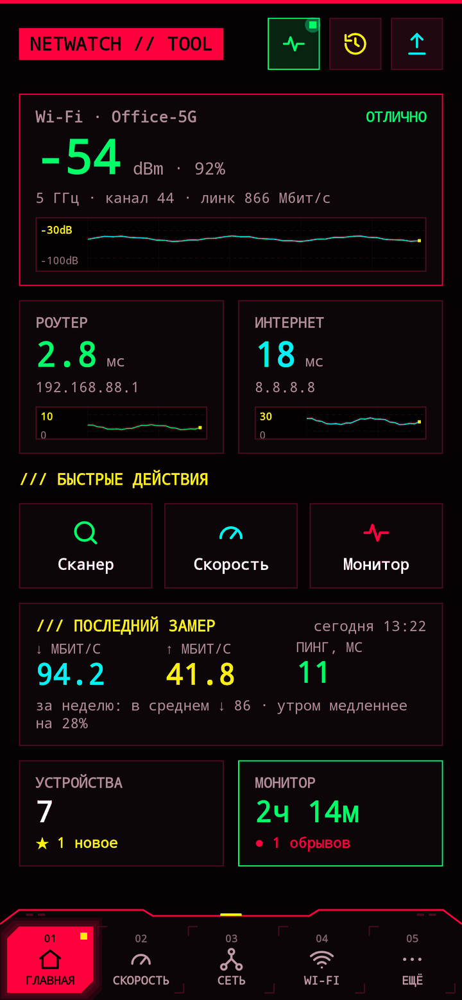
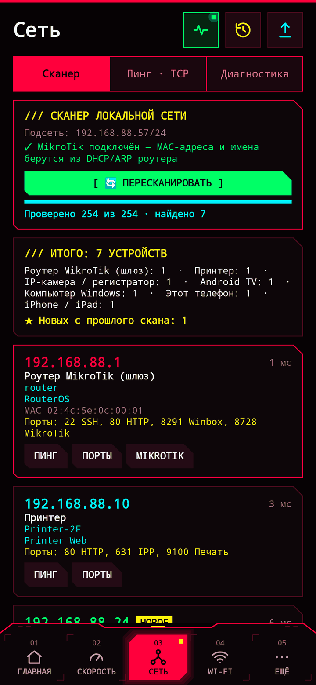
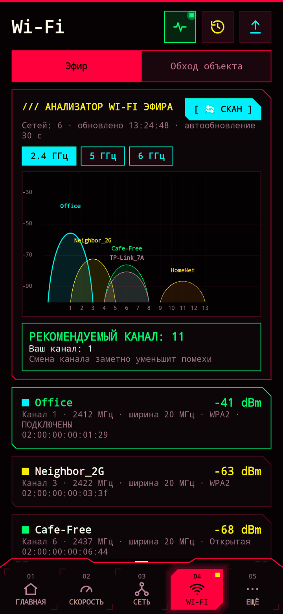
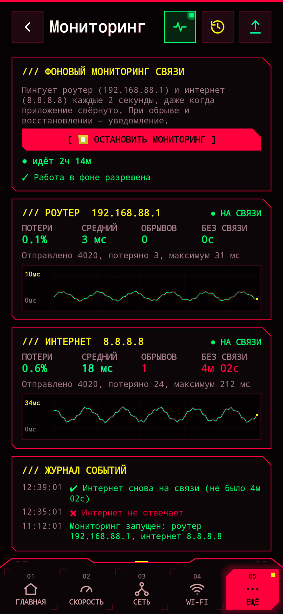
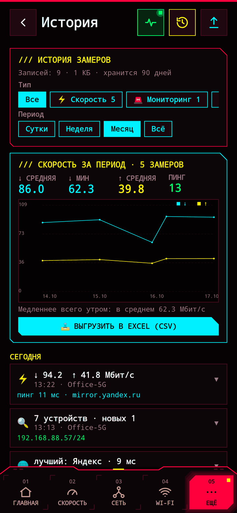
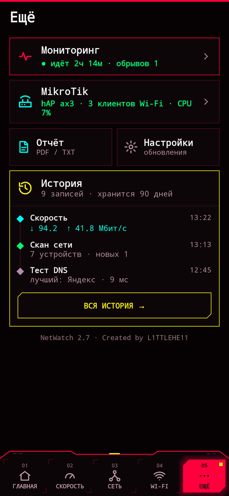

<div align="center">

[English](README.md) | **Русский**


# NetWatch: Network Scanner

**Бесплатный сетевой сканер и Wi-Fi анализатор для Android**<br>
Сканер сети · Wi-Fi эфир · пинг · скорость интернета · мониторинг обрывов · traceroute · порты · MikroTik

[](https://github.com/L1TTLEHE11/NetWatch/raw/main/apk/NetWatch-2.7-universal.apk)
[](#установка)
[](LICENSE)
[](#приватность)

### [📥 Скачать APK](https://github.com/L1TTLEHE11/NetWatch/raw/main/apk/NetWatch-2.7-universal.apk) · [Сайт](https://l1ttlehe11.github.io/NetWatch/ru/)

</div>

<table>
<tr>
<td></td>
<td></td>
<td></td>
<td></td>
</tr>
<tr>
<td></td>
<td></td>
<td></td>
<td></td>
</tr>
</table>

NetWatch — набор инструментов для тех, кто настраивает и чинит сети: от домашнего роутера до офиса или здания с десятком точек доступа. Всё в одном приложении, бесплатно, без рекламы и без сбора данных. Изначально — Android-версия десктопной утилиты NetWatch (Python / Tkinter).

## Возможности

| Раздел | Что умеет |
|---|---|
| **01 Главная** | Сигнал Wi-Fi в dBm с графиком, пинг до роутера и интернета, быстрые действия, последний замер скорости и итог за неделю, устройства в сети, статус мониторинга |
| **02 Скорость** | Многопоточный замер (8 потоков ↓, 6 ↑), цифры и шкалы обновляются 10 раз в секунду, пинг и джиттер, график и история |
| **03 Сеть → Сканер** | Все устройства подсети за 10–30 с, тип устройства (роутер, MikroTik, камера, принтер, Android TV, Smart TV, ПК, iPhone, NAS), открытые порты, имена через NetBIOS, mDNS и UPnP, метка «НОВОЕ» для новых устройств |
| **03 Сеть → Пинг · TCP** | Live-пинг любого узла со статистикой потерь, TCP-тест скорости до устройства в локальной сети, Wake-on-LAN |
| **03 Сеть → Диагностика** | Traceroute, сравнение DNS-серверов (провайдер, Google, Cloudflare, Яндекс, Quad9, AdGuard), сканер портов с расшифровкой служб, интерфейсы и маршруты |
| **04 Wi-Fi → Эфир** | Все сети вокруг, график загрузки каналов 2.4 / 5 / 6 ГГц, рекомендация лучшего канала |
| **04 Wi-Fi → Обход** | Замеры по точкам объекта («кухня», «2 этаж»): сигнал, точка доступа, пинг, потери, скорость; проблемные точки подсвечиваются; выгрузка в Excel и PDF |
| **05 Ещё → Мониторинг** | Фоновая проверка роутера и интернета каждые 2 с, уведомления об обрывах, потери, время без связи, журнал событий |
| **05 Ещё → MikroTik** | RouterOS API (v6 и v7): CPU, память, температура, трафик по интерфейсам, точки CAPsMAN, Wi-Fi клиенты с сигналом, DHCP-аренды |
| **05 Ещё → История** | Все замеры, сканы и сессии сохраняются автоматически; фильтры по типу, сети и периоду; сводка скорости за период с выгрузкой в Excel |

Также: PDF-отчёт одной кнопкой, виджет на рабочий стол, крупный шрифт, обновление прямо из приложения с проверкой SHA-256.

**Языки:** русский и английский — по языку системы, переключаются в «Ещё → Настройки → Язык».

## Установка

1. Скачайте [**NetWatch-2.7-universal.apk**](https://github.com/L1TTLEHE11/NetWatch/raw/main/apk/NetWatch-2.7-universal.apk). Один файл для всех устройств на Android 8.0+ (arm64-v8a, armeabi-v7a, x86, x86_64).
2. Откройте его на телефоне и разрешите установку из этого источника.
3. Разрешите доступ к геолокации, когда приложение попросит: без него Android скрывает имя Wi-Fi сети.

Дальше приложение обновляется само: «Ещё → Настройки → Обновления».

SHA-256: `46dac2f20847979e13fe2b85ff60bfebba8e5c0f7052385ae162ac4d59644f28`

## Приватность

NetWatch **ничего не собирает и никуда не отправляет**: нет аналитики, рекламы, учётных записей и серверов. История замеров хранится только на телефоне. Подробно — в [политике конфиденциальности](https://l1ttlehe11.github.io/NetWatch/ru/privacy.html).

| Разрешение | Зачем |
|---|---|
| `INTERNET`, `ACCESS_NETWORK_STATE`, `ACCESS_WIFI_STATE` | пинги, замеры, параметры сети |
| `ACCESS_FINE/COARSE_LOCATION` | без него Android скрывает SSID и результаты сканирования Wi-Fi; координаты не используются |
| `CHANGE_WIFI_STATE` | запуск сканирования Wi-Fi эфира |
| `FOREGROUND_SERVICE`, `WAKE_LOCK`, `POST_NOTIFICATIONS` | фоновый мониторинг и уведомления об обрывах |
| `REQUEST_INSTALL_PACKAGES` | установка обновлений, скачанных из приложения |

## Перевод

Хотите добавить свой язык? Переведите `app/src/main/res/values/strings.xml` (английский оригинал) и пришлите файл `values-<код языка>/strings.xml` через pull request или issue. Подробности — в [CONTRIBUTING.md](CONTRIBUTING.md).

## Ошибки и предложения

Нашли ошибку или есть идея — [создайте issue](https://github.com/L1TTLEHE11/NetWatch/issues/new/choose). Pull request'ы приветствуются.

## Для разработчиков

**Kotlin + Jetpack Compose**, minSdk 26, targetSdk 35. Без сторонних сетевых библиотек: RouterOS API, mDNS, SSDP, NetBIOS, DNS, Wake-on-LAN реализованы в коде проекта.

```bash
# нужен JDK 17+ и Android SDK (platform 35, build-tools 35)
echo "sdk.dir=/path/to/Android/Sdk" > local.properties
./gradlew assembleFullRelease          # APK: app/build/outputs/apk/full/release/
./gradlew assembleFdroidRelease        # сборка для F-Droid: без встроенного обновления и REQUEST_INSTALL_PACKAGES
./gradlew testFullDebugUnitTest        # тесты протоколов + скриншоты экранов (Robolectric + Roborazzi)
```

<details>
<summary>Подпись, выпуск версий, структура проекта</summary>

**Подпись.** Release подписывается ключом из `keystore.properties` → `keys/netwatch-release.jks` (оба в `.gitignore`). Обновление ставится поверх только при подписи тем же ключом. Без `keystore.properties` сборка подпишется debug-ключом.

**Выпуск версии.**
1. Поднять `versionCode` и `versionName` в `app/build.gradle.kts`.
2. `./gradlew assembleFullRelease`
3. `python3 tools/release.py --en "What's new" … --ru "Что нового" …` — APK в `apk/` (хранятся 3 последние), `update.json`, ссылки в README и на сайте, список изменений для каталогов.
4. `git push`, затем `curl -s https://purge.jsdelivr.net/gh/L1TTLEHE11/NetWatch@main/update.json`.

**Скриншоты для README и сайта:** `./gradlew testFullDebugUnitTest --tests '*DemoShots*'` (экраны с примерными данными → `docs/screenshots/en/` и `docs/screenshots/ru/`), затем `python3 tools/store_art.py .`

```
update.json                — актуальная версия для обновления из приложения
tools/release.py           — выпуск новой версии
docs/                      — сайт (GitHub Pages): английский в корне, русский в docs/ru/
tools/site.py, site_text.py — генератор сайта и тексты (EN / RU)
tools/fdroid/              — описание для репозитория F-Droid
fastlane/metadata/android/ — описания и картинки для каталогов приложений
app/src/main/res/values*/strings.xml — тексты интерфейса (values — английский, values-ru — русский)
app/src/main/java/com/l1ttlehe11/netwatch/
├── NetVm.kt, Features.kt  — состояние и логика экранов
├── Net.kt                 — пинг, Wi-Fi / сотовая сеть, шлюз, замеры скорости
├── Tools.kt               — сканер сети и портов, traceroute, DNS, NetBIOS, Wake-on-LAN
├── Discovery.kt           — обнаружение устройств по mDNS и SSDP/UPnP
├── WifiScan.kt            — сканирование эфира и выбор канала
├── Mikrotik.kt            — клиент RouterOS API
├── Monitor.kt             — фоновый мониторинг
├── History.kt             — хранилище истории и известных устройств
├── Updater.kt             — обновление из приложения
├── Lang.kt                — язык интерфейса (как в системе / вручную)
├── Report.kt, Widget.kt   — отчёты PDF/TXT/CSV, виджет
└── Ui*.kt                 — интерфейс
```
</details>

## Лицензия

[GNU GPL v3](LICENSE) — свободное ПО: его можно использовать, изучать, менять и распространять; изменённые версии тоже должны оставаться открытыми под GPL-3.0.

**NetWatch** · Created by **L1TTLEHE11**
